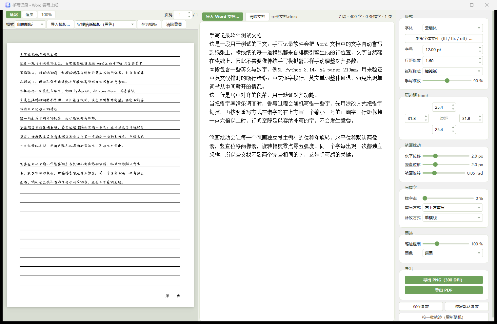

# 手写记录（HandwrittenNotes）

[](https://github.com/Sanskrit-jing/handwritten-notes/releases)
[](https://github.com/Sanskrit-jing/handwritten-notes/releases)

把 Word 文档自动誊写成手写风格的作业纸：导入 .docx → 调整笔迹参数 → 导出 PNG / PDF。字形逐字独立抖动采样，全文找不出两个完全相同的字——这是手写感的关键。



## 功能特性

- **Word 誊写上纸**：导入 .docx 自动解析段落，按信纸横线位置誊写，无需手动对齐
- **手写感字形引擎**：轮廓级抖动（水平/垂直位移、旋转、缩放），随机流 = seed + 页码 + 字符序号，同一参数下预览与导出完全一致
- **双排版模式**：自由排版（纸面编辑器，所见即所得）/ Word 版式（按原文档版面位置誊写，自动重建纸面资产）
- **背景模板**：内置多种信纸模板，支持导入图片或 Word 文档生成模板，可存为模板复用
- **丰富的笔迹参数**：字体、字号、行距、手写缩放、横线纸样式、错开率、笔迹抖动三项、涂改方式、墨色浓淡等
- **逐字涂改模拟**：支持"在错字上方写一个缩小一号的正确字"等真实涂改方式
- **导出**：PNG（300 DPI）逐页导出 / PDF 导出，预览即导出效果
- **参数持久化**：配置自动保存，启动恢复上次的文档与参数

## 下载安装

从 [Releases](https://github.com/Sanskrit-jing/handwritten-notes/releases) 页面下载，两个版本功能完全一致：

| 版本 | 文件 | 大小 | 说明 |
|---|---|---|---|
| 安装版 | `HandwrittenNotes_Setup_1.0.0.exe` | 60.6 MB | 向导式安装，自动创建开始菜单 / 桌面快捷方式，卸载走系统"应用与功能" |
| 便携版 | `HandwrittenNotes_Portable_1.0.0.zip` | 82.5 MB | 解压到任意目录运行 `HandwrittenNotes.exe`，免安装，可放 U 盘随身携带 |

- **安装版**：双击运行安装向导，可勾选"创建桌面快捷方式"；配置保存在安装目录的 `config.json`
- **便携版**：解压即用；配置 `config.json` 生成在 exe 旁边，删掉即重置，适合多机同步

> 两个版本均为 Windows x64，均**不包含第三方手写字体**（版权原因，见下节）。

## 快速上手

1. 点击顶部 **导入 Word 文档…**，选择要誊写的 .docx（仓库自带 `samples/示例文档.docx` 可直接体验；不导入时启动也会自动加载示例）
2. 在右栏调整字体、字号、行距、笔迹抖动、墨色等参数，预览实时刷新（防抖 300ms）
3. 顶部点击 **导出 PNG（300 DPI）** 或 **导出 PDF**，选择输出目录完成
4. 点击 **换一批笔迹（重新随机）** 可整体换一种笔迹风格；满意的效果用 **保存参数** 固定

## 字体说明

因字体版权原因，本仓库与发布包不附带第三方手写字体。程序会自动扫描以下来源的字体供选择：

1. **系统字体**：楷体、仿宋等本机已安装字体自动可用
2. **fonts/ 目录**：exe（或项目根目录）旁的 `fonts/` 文件夹内的 .ttf / .ttc / .otf

想用自己的手写字体：在右栏"字体"面板点击 **浏览字体文件** 直接加载，或将字体文件放入 `fonts/` 目录（便携版在 exe 旁新建该目录即可）。

## 源码运行

要求：Windows 10/11，Python 3.11+。

```powershell
git clone https://github.com/Sanskrit-jing/handwritten-notes.git
cd handwritten-notes
pip install -r requirements.txt
cd web && npm install && npm run build && cd ..
python desktop.py   # 桌面窗口（pywebview）；或 python server.py 后浏览器访问 127.0.0.1:8300
```

可选依赖（仅"用 Word 文档生成背景模板"功能需要，且要求本机装有 Microsoft Word）：

```powershell
pip install pymupdf pywin32
```

## 打包复现

```powershell
pip install pyinstaller
pyinstaller HandwrittenNotes.spec     # 产出 dist/HandwrittenNotes/（onedir 目录）
```

- **安装包**（需 [Inno Setup 6](https://jrsoftware.org/isinfo.php)）：

```powershell
& "$env:LOCALAPPDATA\Programs\Inno Setup 6\ISCC.exe" installer.iss
# 产出 releases/HandwrittenNotes_Setup_*.exe
```

- **便携包**：将 `dist/HandwrittenNotes/` 整个目录压缩为 zip 即可
- `ico/icon.ico` 为程序图标，由 `ico/` 下素材生成

## 项目结构

```
server.py            FastAPI 服务（app/ 引擎的 HTTP 接口 + 托管 web/dist）
desktop.py           桌面入口（pywebview 壳 + 内嵌服务）
app/
  docx_parser.py     Word 文档解析（段落 / 对齐 / 字号）
  layout_engine.py   排版引擎（自由排版 / Word 版式）
  glyph_engine.py    手写感字形引擎（轮廓抖动采样）
  renderer.py        Pillow 纸面渲染
  exporter.py        PNG / PDF 导出
  bg_template.py     背景模板（内置 / 用户 / Word 版式生成）
  fonts.py           字体扫描与族名解析
  params.py          参数持久化（config.json）
  paths.py           资源 / 数据路径（兼容源码运行与打包冻结）
samples/             示例文档与生成脚本
installer.iss        Inno Setup 安装包脚本
HandwrittenNotes.spec  PyInstaller 打包配置
```
